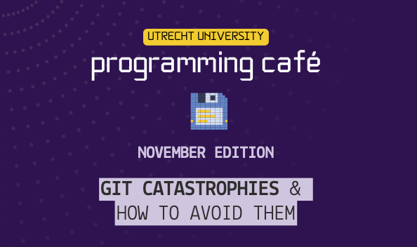
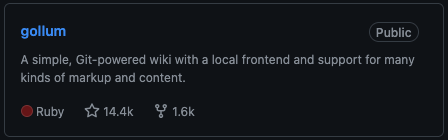
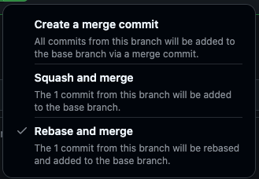

--- 
format: 
  revealjs:
    theme: themes/uu.scss
    logo: images/UU_logo_2021_EN_RGB.png
    footer: "These slides: https://edu.nl/mq64p"
---

#



## Introduction

::: {.theme-section}

Dawa Ometto (@dometto)

Research Engineer, UU ITS

Making life difficult for myself with `git` since 2012:



:::

## Introduction

::: {.theme-section}

Plan:

- Git catastrophes and why they happen
- How to avoid them:
  - Some best practices
  - How to (learn to) understand git
- Exercises:
  - Beginner/intermediate: practice with git disasters!
  - Advanced: build your own git!

:::

## Git Catastrophes

::: {.theme-section}

Who has...

::: {.incremental}


- got stuck in the middle of a merge?
- accidentally committed/pushed changes to the wrong branch?
- accidentally pushed secrets to GitHub?
- somehow lost entire commits?

:::

:::

## Git Catastrophes

::: {.theme-section}

Help is available:

* General git cheatsheet:
  * <https://git-scm.com/cheat-sheet>
* Disaster cheatsheet:
  * <https://ohshitgit.com/>
* Zine by Julia Evans:
  * <https://wizardzines.com/zines/oh-shit-git/>

:::

## Git Catastrophes {.smaller}

::: {.theme-section}

...but why does this keep happening to us?

::: {.incremental}

- git is difficult!
  - but not as bad as you think!
- we're always in a hurry
  - copy/paste is faster
- bad understanding:
  - our mental model is file-first, git is commit-first
  - worktree - staging area - repository
  - relation between local and remote repos (*distribution*)

:::

:::

## Git Catastrophes

::: {.theme-section}

{fig-align="center" height="35%" width="35%"}

:::

## Best practices

::: {.theme-section}

Common questions:

::: {.incremental}

- What branch do I develop on?
  - anything, as long as it's not `main`
- How should I merge?
  - merging vs. rebasing vs. squashing
- What should I commit?

:::

:::

## Best practice: merging

::: {.theme-section}

{fig-align="center"}

::: {.incremental}

- Good news: all are fine!
- Bad news: neither helps you avoid merge conflicts.
- Bad news: you need to understand the difference.
  * ...and you should probably learn rebase (on the `cli`) anyway.

::: 

:::

## Best practice: atomic commits

::: {.theme-section}

Strive (!) to make your commits *atomic*:

> The basic idea of an atomic git commit is that it contains the shortest amount of work that does what it is supposed to do. That is, less work would not be enough to do the task, and more work would be going out of scope. (@abelsiqueira)

:::

## Best practice: atomic commits

::: {.theme-section}

@paulinevos:

1. Single, irreducible unit. Every commits pertains to one fix or feature.
2. Everything works. Don't break the build on any commit.
3. Clear and concise. Purpose is clear from commit message and description.

:::

## Best practice: atomic commits

::: {.theme-section}

> If every commit is an atomic commit, then we have a beautiful git history. Every commit passes tests, so we can easily navigate around. Every commit has a non-creeping purpose, so we can cherry-pick them more easily. Every commit is self-contained, so we can revert them trivially. (@abelsiqueira)

This helps with disaster recovery!

:::

## Best practice: atomic commits

::: {.theme-section}

It also help you avoid this:

{fig-align="center" height="50%" width="50%"}

:::

## Best practice: atomic commits

::: {.theme-section}

But creating atomic commits is hard.

We often don't know what logical 'chunks' our work will end up dividing into, until we've done the work -- and we *do* want to have versioning along the way!

:::

## Best practice: atomic commits {.smaller}

::: {.theme-section}

Solution:

::: {.incremental}

- As you work on a feature branch, try to make your commits *as* atomic as possible.
- When the work is done, review your commit history on that branch:
  * does it contain needless commits? Remove them!
  * does it contain multiple commits that do *less than one* thing? Squash them together!
  * does it contain commits that do *more than one* thing? Split them!
- You must understand git history to rewrite it!

:::

:::

## Understanding git

::: {.theme-section}

How to learn to understand git:

- play around with the `.git` directory!
- (advanced) reverse engineer it...
  - see exercises!

:::

## Understanding git

::: {.theme-section}


:::

## Understanding git

::: {.theme-section}

How to learn to understand git:

- play around with the `.git` directory!
- (advanced) reverse engineer it...
  - see exercises!

:::

## Understanding git

::: {.theme-section}

Every commit is uniquely *defined* by its:

- message
- author info
- date/time
- total state of all the files and directories (*tree*)
- parents

:::

## Understanding git

::: {.theme-section}

```
$ git cat-file commit HEAD
tree 7bbb09e5f1ab20c91e0e57be4ec99c49ba482bac
parent 7656a5f45d263eb0d4a09788dc83aae8106970b4
author Dawa Ometto <d.l.a.ometto1@uu.nl> 1704892164 +0100
committer Dawa Ometto <d.l.a.ometto1@uu.nl> 1704892195 +0100

Use more chili
```

:::

## Understanding git

::: {.theme-section}

So:

  * every commit is a pointer to an entire history.
  * there is not really such a thing as *editing* a commit.

:::

## Understanding git

::: {.theme-section}

A merge commit is a commit that has *multiple parents*:

```
tree 10f6a7c3758039f5d24fac9556646c830655fb14
parent 7656a5f45d263eb0d4a09788dc83aae8106970b4
parent a831dcd01638aebb453fb218bbb8eeebc2e2cf69
author Dawa Ometto <d.l.a.ometto1@uu.nl> 1704899151 +0100
committer Dawa Ometto <d.l.a.ometto1@uu.nl> 1704899151 +0100

Merge branch 'noconflict'
```

:::

## Understanding git

::: {.theme-section}

Having a merge commit makes the history of a branch *non-linear*:


:::

## Understanding git

::: {.theme-section}

Unlike merge commits, rebase-and-merge yields a *linear* history:

{fig-align="center" width="40%" height="40%"}

If there have been no new commits to `main` since `<feature>` was created, this is easy:

- `git` simply records that the branch `main` points to the latest commit in `<feature>` ('fast-forward').

:::

## Understanding git

::: {.theme-section}

Fast-forwarding:

```
testrepo git:(main) $ cat .git/refs/heads/main 
bfe91cdde970ecdffaac357f6253aec288c92396

testrepo git:(main) $ git merge --ff-only feature_branch
Updating bfe91cd..8bbdd62
Fast-forward
 ingredients.txt | 1 +

testrepo git:(main) $ cat .git/refs/heads/main 
8bbdd629aa39af3da8916275ea8be39c412c91a4
```

:::

## Understanding git

::: {.theme-section}

But what if `main` and `<feature>` have divergent histories?

  * then there is no 'link' between the tip of `main` and the start of `<feature>` :-(
  * `rebase` needs to *rewrite history*

:::

## Understanding git

::: {.theme-section}

`git rebase main` *replays* the changes in your current branch *on top of* the last commit in `main`.

**Goal**: get a history that can be merged with a "fast-forward" again!

{fig-align="center"}

:::

## Understanding git

::: {.theme-section}

Rebasing:

* For every commit on the current branch, `git` applies the changes in that commit on top of the latest commit in `main`.
* Merge conflicts may need to be handled for each commit that is 'replayed'.
* This creates new commits!

:::

## Exercises

::: {.theme-section}

- Practice disaster recovery skills
  - <https://edu.nl/hvd4p>
- Build your own git (`μgit`)
  - <https://www.leshenko.net/p/ugit/>

:::

## References {.smaller}

* Utopian Git History (Abel Soares Siqueira, eScience Center)
  * <https://blog.esciencecenter.nl/the-utopic-git-history-d44b81c09593>
  * <https://blog.esciencecenter.nl/achieving-utopic-git-history-4cc2a1fd3107>
* Atomic commits will help you git legit (Pauline Vos)
  * <https://dev.to/paulinevos/atomic-commits-will-help-you-git-legit-35i7>
* The git book (Scott Shacon, Ben Straub):
  * <https://git-scm.com/book/en/v2/>
* Blog posts by Julia Evans:
  * <https://jvns.ca/blog/2023/11/06/rebasing-what-can-go-wrong-/>
  * <https://jvns.ca/blog/2023/11/01/confusing-git-terminology/>
  * <https://jvns.ca/blog/2024/01/26/inside-git/>
